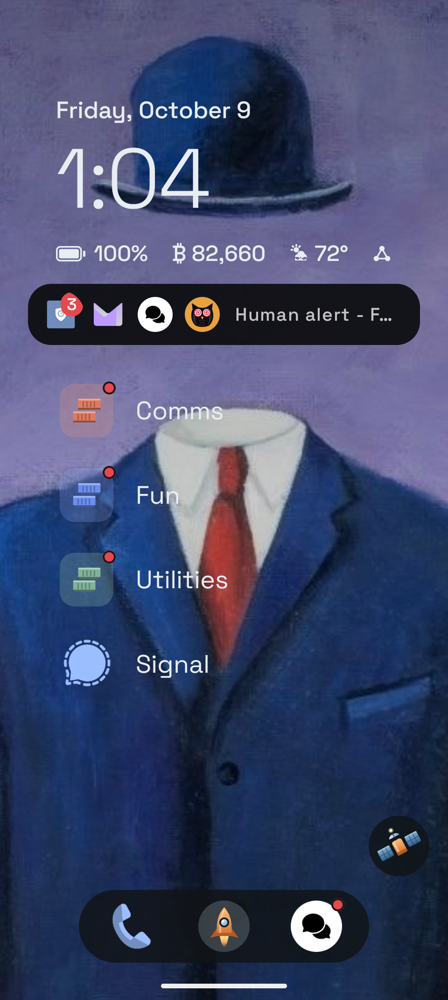

# Gantry 🚀

A simple, private launcher for GrapheneOS.



Gantry is a vertical, one-handed launcher with a glanceable dashboard and a
security story none of the alternatives have: the **Airlock** — Android's
private space repurposed as a containment area for apps that track. Your
clean apps launch from the gantry as normal; seal the airlock and the
tracking apps inside are fully stopped. The rocket in the dock tells you at
a glance whether containment is open.

## Features

- **Home dashboard** — date, weather, big clock, battery, price ticker, and a
  now-playing widget. Every component can be toggled, configured, and given a
  custom tap action.
- **Airlock** — contained apps show amber rings and hatch glyphs everywhere;
  tap a sealed app to unlock-and-launch in one motion; long-press the dock
  rocket to seal/open. Uninstalls target the right profile.
- **Tags** — the single organization model: Home and Dock are reserved tags,
  custom tags group and filter the drawer, everything is drag-reorderable.
- **Drawer** — alphabet rail with magnifier scrubbing, search where Enter
  launches the best match, notification dots and optional one-line previews.
- **Appearance** — adaptive/custom text color, highlight color, ten bundled
  OFL fonts with live previews, font-size slider, custom background image
  (with pan/zoom positioning) or solid color.
- **Offline by default** — no analytics, no Google dependencies. Weather
  (Open-Meteo), the price ticker (Kraken or any HTTPS JSON endpoint), media,
  and device location are individually opt-in; revoke the Network permission
  and Gantry keeps working.

## Install

- **F-Droid**: coming soon.
- **GitHub**: download `gantry-<version>.apk` from the
  [latest release](https://github.com/mesmerverse/gantry/releases/latest).
  Releases are signed with the same key, so updates install over the top and
  keep your data.

Signing certificate SHA-256:
`c4:ea:d7:1e:07:85:ee:73:dd:d9:69:3e:ae:e7:9c:d3:7b:5b:19:88:74:c0:d6:6f:82:30:c6:73:da:f0:71:58`

After install, set Gantry as the default launcher (Settings → Apps → Default
apps → Home app) so the Airlock features work. Grant notification access from
Gantry's Settings → Permissions if you want the media widget and notification
previews.

Gantry was previously named **Rocket** (`com.mesmerverse.rocket`). The rename
changed the application id, so Gantry installs as a separate app.

## Building

```
./gradlew assembleRelease
```

Requires a full JDK (e.g. Android Studio's bundled JBR) and an Android SDK
with platform 36. Release signing reads `signing.properties` at the repo
root (gitignored, never committed); without it the release build is unsigned.

```properties
ANDROID_KEYSTORE_PATH=/path/to/release.keystore
ANDROID_KEYSTORE_PASSWORD=…
ANDROID_KEY_ALIAS=…
ANDROID_KEY_PASSWORD=…
```

## Fonts

Bundled fonts (Space Grotesk, Inter, Manrope, Nunito, Outfit, Rubik, Sora,
Work Sans, JetBrains Mono) are SIL Open Font License; see `licenses/`.

## License

Gantry is free software: you can redistribute it and/or modify it under the
terms of the [GNU General Public License v3.0](LICENSE). Bundled fonts remain
under their own licenses (above).
